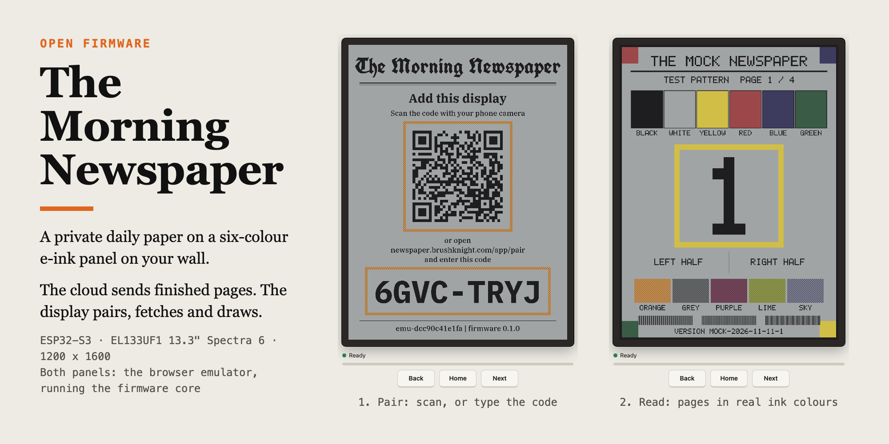
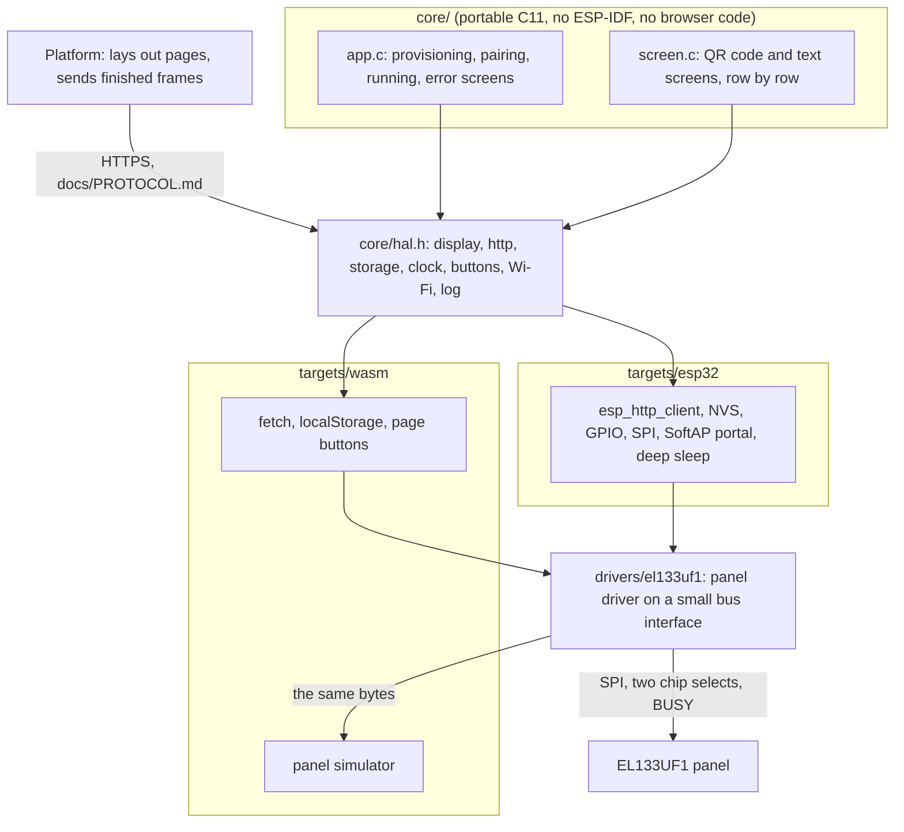

<p align="center"></p>

<p align="center">
  <a href="https://github.com/brushknight/newspaper/actions/workflows/ci.yml"></a>
  <a href="https://github.com/brushknight/newspaper/releases/latest"></a>
  
  <a href="https://brushknight.github.io/newspaper/"></a>
</p>

# The Morning Newspaper, firmware

**Open firmware for a wall display that shows your own daily newspaper on a six-colour e-ink panel.**

The Morning Newspaper is a private daily paper that your AI assistant writes for you. This repo is the part that hangs on the wall: an ESP32-S3 driving a 13.3 inch E Ink Spectra 6 panel. The cloud sends finished pages; the display just pairs, fetches and draws. The firmware is open so that anybody can build a display and attach it to the platform at https://newspaper.brushknight.com. The same code also runs in your browser as an emulator, so you can try it before you own any hardware.

> **Honest status:** the panel driver is UNTESTED ON HARDWARE. The panel had not arrived when this was written. Everything else below says plainly what has been run and what has not.

- [What you need](#what-you-need)
- [Quick start](#quick-start)
- [Try it in the browser](#try-it-in-the-browser)
- [Pairing in detail](#pairing-in-detail) · [Buttons and behaviour](#buttons-and-behaviour)
- [Build from source](#build-from-source) · [Run against the mock platform](#run-against-the-mock-platform)
- [How it works](#how-it-works) · [Protocol](#protocol)
- [What is tested and what is not](#what-is-tested-and-what-is-not) · [Releases](#releases) · [License](#license)

## What you need

- **The panel:** a Pimoroni Inky Impression 13.3" (E Ink Spectra 6, panel EL133UF1, 1200 x 1600, six inks). The Waveshare 13.3inch e-Paper HAT+ (E) and the Good Display GDEP133C02 carry the same panel.
- **An ESP32-S3 board** with 4 MB of flash or more. PSRAM is not needed; frames are streamed to the panel.
- **Three push buttons:** Next, Back and Home. The Inky Impression has buttons of its own that can serve.
- **A USB-C cable that carries data**, for flashing and for power.
- **An account** on https://newspaper.brushknight.com.

Which board is tested? **None yet.** No board has been chosen and the firmware has never run on a chip. Every pin is a build option with a sensible default; the wiring table is in [docs/HARDWARE.md](docs/HARDWARE.md). If you wire one up, expect to debug the panel driver.

## Quick start

1. **Flash a release.** Download `newspaper-display-<version>-esp32s3-merged.bin` from the [latest release](https://github.com/brushknight/newspaper/releases/latest) and write it at address 0:

   ```sh
   pip install esptool
   esptool.py --chip esp32s3 --port /dev/ttyACM0 write_flash 0x0 newspaper-display-<version>-esp32s3-merged.bin
   ```

   This repo ships no web flasher of its own. A browser based ESP flasher such as Espressif's [esptool-js](https://espressif.github.io/esptool-js/) can write the same file at address `0x0`. More detail, and the separate parts, in [docs/FLASHING.md](docs/FLASHING.md). Release binaries use the default pins.

2. **Join the display's Wi-Fi setup network.** The panel shows a QR code for a network called `Newspaper-XXXX`. Scan it with your phone, pick your home network on the page that opens, and type its password.

3. **Add the display to your account.** The panel now shows a second QR code and a code like `K7QF-3MXD`. Do one of:
   - scan the QR code with your phone,
   - open https://newspaper.brushknight.com/app/pair and type the code,
   - ask your assistant to adopt it ("adopt display K7QF-3MXD and call it Kitchen").

The front page appears as soon as the panel is allowed to refresh again, within about three minutes.

## Try it in the browser

**https://brushknight.github.io/newspaper/** (published with each release, so the link works once the first release is out).

The emulator is the firmware's own core and panel driver compiled to WebAssembly, driving a simulated panel. It pairs with the real platform like a hardware display and receives byte-identical frames. It simulates the panel honestly, not as an instant canvas:

- **The slow, flashing refresh.** Nothing changes until the refresh command. Then the whole screen flashes between ink states for 12 to 20 seconds before the picture settles, and the BUSY line is held the whole time.
- **The real ink colours.** Spectra 6 white is a light grey and its red is closer to brick. Switch between "Panel colours" and "Ideal colours" to compare.
- **The 180 second minimum** between refreshes. A bar under the panel shows the rest period. A refresh that comes too early is refused and counted as a rule violation.
- **A speed control:** real time, 4x, or instant.

Settings come from the query string:

| Parameter | Meaning |
| --- | --- |
| `api=URL` | Platform base URL. Default `https://newspaper.brushknight.com`. `self` means the origin the page is served from. |
| `speed=1`, `4` or `instant` | Panel time scale. `instant` refreshes in a quarter of a second and drops the rest period. |
| `colors=panel` or `ideal` | Ink colours as on the panel, or pure colours. |
| `device=NAME` | Storage namespace, so several virtual displays can live in one browser. |
| `reset=1` | Forget the stored token first. |
| `wifi=0` | Start without Wi-Fi to see the provisioning screen (the page shows a stand-in for the setup page). |
| `embed=1` | Only the framed panel and its three buttons, for an iframe. |
| `log=0` | Hide the log. |

Keys: left arrow is Back, right arrow is Next, H or Home is Home.

The page is static (`index.html`, three `.js` files, one `.wasm`) and can be embedded in an iframe. It reports to its parent with `postMessage`: `{source: "newspaper-emulator", type: "state", state, user_code, verification_uri_complete, screen, page, pages, refreshing}`. It accepts `{target: "newspaper-emulator", type: "button", button: "next" | "back" | "home"}` and `{target: "newspaper-emulator", type: "set", speed, colors}`. When it is served from another origin than the platform, the platform has to allow that origin through CORS.

## Pairing in detail

Pairing follows the OAuth device flow in spirit ([docs/PROTOCOL.md](docs/PROTOCOL.md) section 1).

1. **No Wi-Fi credentials.** The display opens an access point `Newspaper-XXXX` with a captive portal and draws a Wi-Fi QR code for it. The portal lists nearby networks and stores your choice. If the credentials do not work the first time, the display returns to this step by itself.
2. **No token.** The display asks the platform for a pairing code and draws a QR code of the pairing link, the address, and the code in large type. It then polls every few seconds.
3. **Adopted.** When you (or your assistant) adopt the code, the next poll returns a device token. The display stores it and never shows it.
4. **Codes expire** after about 15 minutes; the display fetches a new one and redraws. After four unused codes it stops and shows "Pairing paused"; any button starts again. This keeps an unclaimed display from refreshing its panel forever.
5. **Removed in the web app?** The next call answers 401, the display forgets its token and returns to step 2.

To start over with new Wi-Fi or a new account, hold **Home** while plugging the display in and keep it held for five seconds.

## Buttons and behaviour

- **Next** and **Back** turn pages and wrap around. **Home** returns to the front page.
- Presses during a refresh are ignored. Presses during the panel's rest period are remembered and collapse into one page turn.
- Pages turn by themselves if the platform sets a page interval. The display asks the platform for news every check interval (30 minutes by default) and redraws only when the issue's version changed. A new day's issue starts on its front page.
- A refresh is never interrupted, and never starts sooner than 180 seconds after the last one ended.
- Network trouble never wipes the newspaper: the last page stays up and the display retries quietly. Error screens appear only during setup.
- Between activities the ESP32 sleeps deeply and wakes on a timer or a button.

## Build from source

```sh
git clone https://github.com/brushknight/newspaper && cd newspaper
```

**Host tests** (CMake and a C compiler):

```sh
cmake -S . -B build && cmake --build build
ctest --test-dir build --output-on-failure
```

**Browser emulator** ([Emscripten](https://emscripten.org) and Node 22 or newer):

```sh
source ~/emsdk/emsdk_env.sh
./targets/wasm/build.sh              # writes the static site to targets/wasm/dist
```

**ESP32-S3 firmware** (ESP-IDF v5.x, developed with v5.5.2):

```sh
. ~/esp/esp-idf/export.sh
cd targets/esp32
idf.py set-target esp32s3
idf.py menuconfig                    # "Morning Newspaper display": pins, API base URL, sleep
idf.py build
idf.py -p /dev/tty.usbmodemXXXX flash monitor
```

## Run against the mock platform

`tools/mock-server` is a small stand-in for the platform (Node, no dependencies). It implements the protocol and serves made-up test pattern pages with page numbers and all six inks.

```sh
node tools/mock-server/server.js --static targets/wasm/dist
```

Open `http://127.0.0.1:8787/emulator/?api=self&speed=4`. The panel shows the pairing screen. Adopt it from a second terminal, or follow the "open pairing page" link next to the code:

```sh
node tools/mock-server/adopt.js                      # adopts the newest pending code
curl -X POST http://127.0.0.1:8787/mock/bump         # new version: the display redraws at its next check
curl -X POST http://127.0.0.1:8787/mock/remove       # remove the display: it returns to pairing
```

All options and helper endpoints are listed at the top of [tools/mock-server/server.js](tools/mock-server/server.js). For real hardware, start the mock with `--host 0.0.0.0`, set the API base URL in menuconfig to `http://<your computer's LAN address>:8787`, and turn deep sleep off to keep the serial log.

The whole loop can be checked without a person: `node tools/e2e/emulator-e2e.js` starts the mock, opens the emulator in headless Chrome, pairs, and compares what the simulated panel shows with the frames the mock sent.

To run a local emulator build against the real platform, serve `targets/wasm/dist` from any static host and open it with `?api=https://newspaper.brushknight.com`.

## How it works



- **`core/`** is the whole application. It talks only to the function table in `core/hal.h`: display (begin frame, write a piece of half 0 or 1, refresh, busy, power off), HTTP with a streaming body callback, key/value storage, clock and idle timer, buttons, Wi-Fi and provisioning hooks, log.
- **Frames are streamed.** A frame is 960,000 bytes; the core passes each piece from the network to the panel as it arrives. Setup screens are rendered row by row. No full frame buffer exists anywhere.
- **`drivers/el133uf1/`** is the panel driver, also portable. On the ESP32 its bus is SPI and GPIO; in the browser its bus is the simulator, which decodes the same command and data bytes.
- **`tests/`** runs the core against a fake HAL with a fake clock and a small model of the platform.

```
core/                  state machine, setup screens, fonts, JSON reader
drivers/el133uf1/      panel driver (UNTESTED ON HARDWARE)
targets/esp32/         ESP-IDF project
targets/wasm/          emulator build and web page
tests/                 host unit tests (CMake + ctest)
tools/mock-server/     mock platform        tools/e2e/   headless browser check
tools/fonts/           font generator and font licences
third_party/qrcodegen/ Nayuki's QR Code generator (MIT), unmodified
docs/                  PROTOCOL.md, HARDWARE.md, FLASHING.md
```

## Protocol

[docs/PROTOCOL.md](docs/PROTOCOL.md) is the contract between a display and the platform: pairing, the device API, expected behaviour, and the `el133uf1` frame format (two 600 x 1600 halves, four bits per pixel). The firmware implements it as written.

## What is tested and what is not

Tested:

- **Core logic, on the host** (15 cases in `tests/test_core.c`): the pairing flow with poll interval, expiry and the pause after four unused codes; re-pairing on 401; a version change redraws and an unchanged one does not; button navigation with wrap, and presses during a refresh being ignored; the minimum refresh interval under page turns that come too fast; the page timer; frames streamed in odd chunk sizes landing in the right half at the right offset; 503 with Retry-After, truncated frames and network loss; restoring after a deep sleep restart; provisioning; Wi-Fi failure; setup screens being valid `el133uf1` frames.
- **Driver logic, on the host** (`tests/test_driver.c`): which bytes go to which chip select, command order, refusal of misuse. This checks the code against itself, not against a panel.
- **The whole device in a browser, against the mock platform** (`tools/e2e/emulator-e2e.js`): pairing, pages that match the mock's frames pixel for pixel through the driver and the simulator, navigation, re-pairing after 401, the provisioning stand-in, the refresh duration and the rest period.
- **The ESP32-S3 firmware compiles and links** with ESP-IDF v5.5.2.

Not tested:

- **Anything on real hardware.** The firmware has never run on a chip. That covers the SPI panel driver and its init sequence, BUSY handling, holding a chip select low while a frame downloads, the captive portal on real phones, NVS, button debounce and wake, and deep sleep.
- **The real platform.** Only the mock has been exercised from this repo, in the browser and nowhere else.
- **The CI and release workflows.** They are written but have not run on GitHub yet.
- The simulator's refresh animation is an impression of a Spectra 6 refresh, not a measurement.

Known gaps: no battery gauge (mains power is assumed), no over-the-air update, `quiet_hours` and `timezone` from the platform are ignored, and the Wi-Fi setup network is open.

## Releases

- Release tags are date based: `YYYY.MM.DD.N`, for example `2026.11.11.1`, where N counts the releases of that day. The tag becomes the firmware version the display reports.
- Publishing a GitHub release attaches the firmware (one merged flashable `.bin`, a zip with the separate parts, a flashing note, checksums) and a zip of the emulator site, and publishes the emulator to https://brushknight.github.io/newspaper/. See `.github/workflows/release.yml`.
- Every push and pull request runs the host tests, the mock platform self test, the emulator build with its headless Chrome check, and the firmware build. See `.github/workflows/ci.yml`.
- One-time repo setup: set GitHub Pages to "GitHub Actions" as its source, and let the `github-pages` environment accept deployments from tags.

## License

MIT, see [LICENSE](LICENSE).

- The panel driver is ported from [Pimoroni's Inky library](https://github.com/pimoroni/inky) (`inky/inky_el133uf1.py`, MIT) and cross-checked with [Waveshare's epd13in3E driver](https://github.com/waveshareteam/e-Paper).
- QR codes come from the [QR Code generator library](https://www.nayuki.io/page/qr-code-generator-library) by Project Nayuki (MIT), in `third_party/qrcodegen`.
- The fonts in `core/fonts/np_fonts.c` are bitmap renderings of UnifrakturCook and IBM Plex Serif and Mono, under the SIL Open Font License 1.1. That one generated file stays under the OFL; the licence texts are in `tools/fonts/`.
- The simulator's ink colours are the values published in Pimoroni's Inky library.
